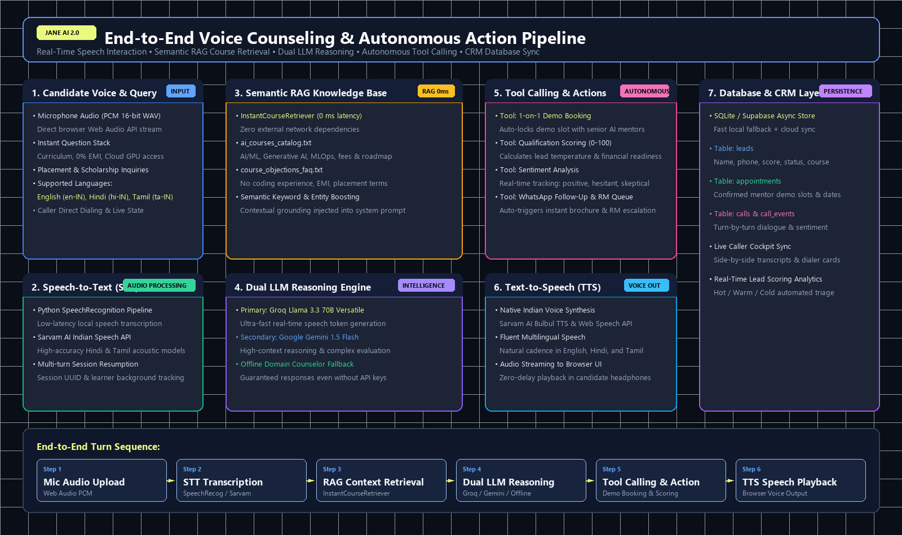

<p align="center">
  
</p>

<h1 align="center">Jane AI — Intelligent Multilingual Voice Agent & Course Counselor</h1>

<p align="center">
  <em>India's premier AI & Machine Learning Academy counseling platform. Real-time voice counseling in English, Hindi & Tamil with automated demo booking, sentiment analysis & CRM lead qualification.</em>
</p>

<p align="center">
  <a href="https://github.com/abinavgt/Jane-AI"></a>
  
  
  
  
  
</p>

---

## 🚀 About Jane AI

In course counseling and admissions, the vast majority of high-intent candidates don't decline — they simply drop off because no counselor contacts them while their interest is at its peak.

**Jane AI** provides instantaneous, intelligent, real-time voice counseling for AI & Machine Learning certification programs:
- High-intent candidates are engaged immediately through interactive voice counseling.
- Candidates' eligibility, academic/career background, and financial readiness are evaluated in real time.
- 1-on-1 mentor demo sessions are automatically scheduled directly into the CRM.
- Hot leads are routed to Relationship Managers, while warm leads receive WhatsApp follow-ups.

---

## 🔄 System Architecture & Workflow Pipeline

<p align="center">
  
</p>

The working prototype integrates **Speech-to-Text (STT)**, **Semantic RAG Knowledge Retrieval**, **Dual LLM Orchestration**, **Autonomous Tool Calling** (qualification scoring & CRM demo booking), and **Text-to-Speech (TTS)** voice synthesis:

1. **🎙️ Speech-to-Text (STT) & Audio Capture**: Candidate speech is captured via the browser Web Audio API (PCM 16-bit WAV) and transcribed with Python SpeechRecognition / Sarvam AI acoustic models with multilingual processing in English (`en-IN`), Hindi (`hi-IN`), and Tamil (`ta-IN`).
2. **🧠 0ms Semantic RAG Retrieval**: The `InstantCourseRetriever` dynamically indexes the course catalog (`ai_courses_catalog.txt`) and objections FAQ (`course_objections_faq.txt`), injecting grounded facts regarding curriculum, fees, 0% EMI financing, and cloud GPU lab access directly into the LLM prompt.
3. **⚡ Dual LLM Reasoning Engine**: Dialogue is routed through Groq (`llama-3.3-70b-versatile`) for sub-second token generation, backed by Google Gemini 1.5 Flash and an offline domain counselor rule engine for zero downtime.
4. **🛠️ Autonomous Tool Calling**: Automatically calculates a 0–100 lead qualification score, monitors sentiment (positive, hesitant, skeptical), auto-locks 1-on-1 demo sessions with senior mentors into the CRM, and dispatches automated WhatsApp follow-ups.
5. **🗣️ Text-to-Speech (TTS) Voice Synthesis**: Generates audio responses with Sarvam AI Bulbul TTS and browser speech synthesis, streaming audio directly to the candidate while syncing metrics in real-time to the caller cockpit.
6. **💾 Database & CRM Layer**: State and multi-turn records are persisted across `leads`, `calls`, `call_events`, and `appointments` tables in SQLite / Supabase.

---

## ✨ Key Features

- 🎙️ **Live Browser Microphone Counseling**: Speak naturally via your browser microphone. Jane AI transcribes your query in real-time, analyzes the curriculum and roadmap, and responds vocally with zero perceptible lag.
- 🗣️ **Multilingual Intelligence**: Native, fluent counseling across **English (`en-IN`)**, **Hindi (`hi-IN`)**, and **Tamil (`ta-IN`)**.
- 💡 **Instant Question Stack**: One-click quick queries covering course curriculum, EMI & financing (0% interest), cloud GPU lab access, placement guarantees, and scholarship tests.
- 📞 **Caller Cockpit & Lead Hub**: Comprehensive dashboard with candidate contacts, direct dialer actions, one-click phone copy, and side-by-side conversational transcripts.
- 📊 **Real-Time Sentiment & Qualification Engine**: Continuous turn-by-turn sentiment tracking and automated 0–100 lead score calculation.
- 📅 **Automated 1-on-1 Demo Booking**: Detects booking intent during conversations and automatically locks appointments with senior mentors into the CRM.
- ⚡ **Resilient Dual LLM + Intelligent Offline Fallback**: Primary routing through Groq (`llama-3.3-70b-versatile`) with automatic failover to Google Gemini Flash, backed by an offline heuristic counseling engine that works even without external API credentials.

---

## 🛠️ Tech Stack

| Layer | Technologies |
|---|---|
| **Frontend** | React 18, Vite 5, Tailwind CSS, Framer Motion, TanStack Query, Lucide Icons, Web Audio API |
| **Backend** | FastAPI, Python 3.11+, Uvicorn, LangChain, Pydantic Settings, SpeechRecognition |
| **LLM & Voice** | Groq (Llama 3.3 70B), Google Gemini Flash, Sarvam AI / Browser Speech Synthesis |
| **Knowledge Base** | Lightweight Semantic Keyword & Phrase RAG Retriever (`0 ms` retrieval, offline-ready) |
| **Database** | SQLite (local) / Supabase (cloud persistence) |

---

## 📂 Project Structure

```
Jane-AI/
├── backend/
│   ├── demo/
│   │   ├── __init__.py
│   │   └── simulator.py           # Simulated student personas & caller scenarios
│   ├── knowledge/
│   │   ├── ai_courses_catalog.txt # Course catalog, pricing, roadmap & curriculum
│   │   ├── course_objections_faq.txt # Frequently asked questions & objection handling
│   │   └── loader.py              # Zero-overhead semantic RAG knowledge retriever
│   ├── models/
│   │   ├── call.py                # Call event and session schemas
│   │   ├── lead.py                # Lead models and CRM validation
│   │   └── score.py               # Lead scoring thresholds & metrics
│   ├── prompts/
│   │   └── system_prompt.py       # Counselor system persona & multilingual prompt rules
│   ├── routers/
│   │   ├── calls.py               # Call recording and event endpoints
│   │   ├── dashboard.py           # Analytics, course catalog & appointment APIs
│   │   ├── leads.py               # Lead listing, creation and mock seed data
│   │   ├── voice.py               # Live voice interaction, STT & appointment booking
│   │   └── webhooks.py            # Telephony provider & CRM webhook callbacks
│   ├── services/
│   │   ├── call_service.py        # Telephony session orchestration
│   │   ├── conversation.py        # Multi-turn dialogue management & state tracking
│   │   ├── language.py            # Multilingual language identification & normalization
│   │   ├── llm.py                 # Dual LLM failover (Groq + Gemini + Offline Fallback)
│   │   ├── memory.py              # In-memory session dialogue store
│   │   ├── objection_handler.py   # Automated handling for price/time/eligibility concerns
│   │   ├── rm_handoff.py          # Relationship manager escalation workflows
│   │   ├── sarvam.py              # Sarvam AI STT/TTS service integration
│   │   ├── scoring.py             # 0-100 qualification scoring logic
│   │   └── whatsapp.py            # Automated WhatsApp follow-up notifications
│   ├── .env.example               # Backend environment variable template
│   ├── config.py                  # Pydantic BaseSettings configuration loader
│   ├── database.py                # SQLite / Supabase async database abstraction
│   ├── Dockerfile                 # Production backend container build
│   ├── main.py                    # FastAPI application entrypoint & middleware
│   ├── Procfile                   # Process file for Heroku / Railway
│   └── requirements.txt           # Python backend dependencies
│
├── frontend/
│   ├── src/
│   │   ├── components/            # UI components (sidebar, modals, transcript viewer, dialer)
│   │   ├── hooks/                 # Custom React hooks (useAudioRecorder, useVoiceChat)
│   │   ├── lib/                   # API client configuration (Axios baseURL setup)
│   │   ├── views/                 # Core pages (Dashboard, Live Counselor, Leads, Analytics)
│   │   ├── App.jsx                # Main application component & routes
│   │   ├── index.css              # Global styles & Tailwind utilities
│   │   └── main.jsx               # React DOM entrypoint
│   ├── index.html                 # HTML template
│   ├── package.json               # Frontend dependencies & build scripts
│   ├── postcss.config.js          # PostCSS configuration
│   ├── tailwind.config.js         # Tailwind theme & color definitions
│   ├── vercel.json                # Vercel client-side SPA routing rewrites
│   └── vite.config.js             # Vite bundler configuration & local API proxy
│
├── docs/
│   ├── workflow.png               # High-resolution system architecture & workflow diagram
│   └── workflow.svg               # Vector SVG architecture diagram
├── .gitignore                     # Git ignore rules for node_modules, .env, venvs
├── render.yaml                    # Full-stack Blueprint for 1-click deployment on Render
├── vercel.json                    # Root Vercel fullstack rewrite & build configuration
└── README.md                      # Project documentation
```

---

## ⚙️ Environment Variables

Create a `.env` file in the `backend/` directory (you can copy `.env.example`):

| Variable | Description | Required | Default |
|---|---|---|---|
| `DEMO_MODE` | Runs the agent in standalone demo mode with pre-seeded personas | No | `true` |
| `BASE_URL` | Public or local base URL for the backend server | No | `http://localhost:8000` |
| `FRONTEND_URL` | Origin URL of the frontend application | No | `http://localhost:5173` |
| `PORT` | Port number the backend server listens on | No | `8000` |
| `GROQ_API_KEY` | Groq API key for Llama 3.3 70B inference | Optional in demo mode | `""` |
| `GEMINI_API_KEY` | Google Gemini API key for fallback reasoning | Optional in demo mode | `""` |
| `SARVAM_API_KEY` | Sarvam AI key for specialized Indian language TTS/STT | Optional | `""` |
| `SUPABASE_URL` | Supabase project URL (for persistent cloud storage) | Optional | `""` |
| `SUPABASE_SERVICE_KEY` | Supabase service role secret key | Optional | `""` |
| `EXOTEL_API_KEY` | Exotel telephony key for real outbound calling | Optional | `""` |
| `TWILIO_ACCOUNT_SID` | Twilio SID for backup telephony | Optional | `""` |

> **Note**: When `DEMO_MODE=true` is enabled, external API keys are optional. If keys are omitted or credit limits are reached, the agent seamlessly switches to the built-in domain counselor engine.

---

## 💻 Local Development

### Prerequisites
- **Python**: 3.11 or higher
- **Node.js**: v18 or higher (v20+ recommended)
- **Git**

### 1. Clone the Repository
```bash
git clone https://github.com/abinavgt/Jane-AI.git
cd Jane-AI
```

### 2. Backend Setup
```bash
cd backend

# Create virtual environment
python -m venv .venv

# Activate virtual environment
# Windows (PowerShell):
.\.venv\Scripts\Activate.ps1
# macOS / Linux:
source .venv/bin/activate

# Install dependencies
pip install -r requirements.txt

# Start backend server
python -m uvicorn main:app --host 0.0.0.0 --port 8000 --reload
```
The FastAPI backend will start at **http://localhost:8000**. Interactive OpenAPI Swagger docs are available at **http://localhost:8000/docs**.

### 3. Frontend Setup
In a separate terminal:
```bash
cd frontend

# Install dependencies
npm install

# Start Vite development server
npm run dev
```
Open **http://localhost:5173** in your browser to launch the Jane AI counseling interface.

---

## 📄 License

Distributed under the MIT License. See [LICENSE](LICENSE) for more details.

© 2026 [Jane AI Team](https://github.com/abinavgt/Jane-AI). All rights reserved.
